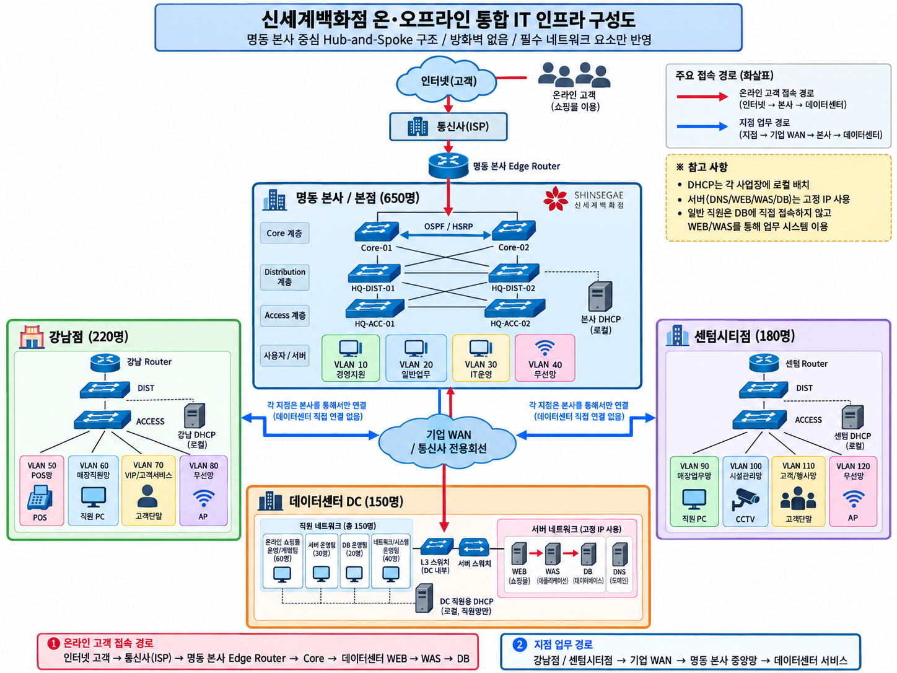
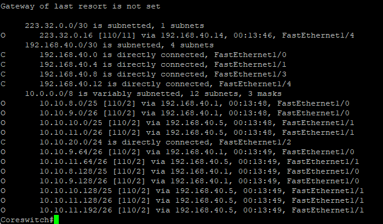
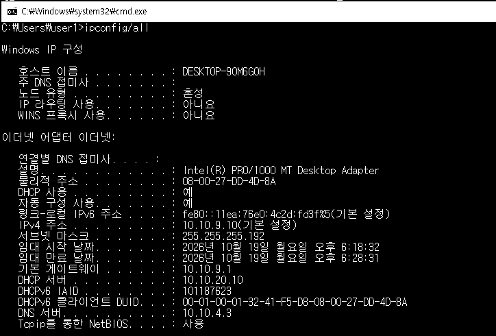

> **STK 보안 솔루션 SE 지원용 브랜치** · 기존 교육 프로젝트의 원본과 증빙을 유지하면서 고객 환경 파악, 장애 분리, 검증 근거 중심으로 정리했습니다.  
> **[STK SE 포트폴리오 요약 및 보안 프로젝트 연결 보기](docs/stk-security-se-portfolio.md)** · **[별도 BYTE BACK 인증·접근통제 프로젝트](https://github.com/hongbin9305/choi-bujang-secret-vault)**  
> 이 저장소는 교육용 가상 환경에서 수행한 강남점 네트워크 프로젝트이며, 상용 구축·고객사 PoC 경험을 의미하지 않습니다.

---

# 백화점 통합 네트워크 인프라 구축 | 강남점 담당

> **GNS3·Cisco IOS·Rocky Linux 기반 교육용 팀 프로젝트**  
> 요구사항에 따른 망 분리와 라우팅 구성부터 장애 진단·동작 확인까지 수행한 기록입니다.

| 항목 | 내용 |
|---|---|
| 수행 기간 | 2026.09.17 ~ 2026.09.23 |
| 프로젝트 | 백화점 온·오프라인 통합 IT 인프라 구축 (5인 팀) |
| 담당 범위 | **강남점** 네트워크 주소·VLAN 설계, GNS3 구성 및 테스트 |
| 실습 환경 | GNS3, Cisco IOS, Rocky Linux 9, Windows 가상 PC |
| 주요 기술 | VLAN, VLSM, SVI, Inter-VLAN Routing, OSPF, DHCP, DHCP Relay, Ping/CLI 검증 |

**핵심 경험:** 부서·층별 단말 수에 따라 `10.10.8.0/22` 대역을 나누고, Access–Distribution–Core 계층형 네트워크를 구성했습니다. DHCP 서버까지의 IP 통신은 정상이지만 클라이언트 주소 할당이 실패하는 문제를 단계별로 점검해 해결했습니다.

> **범위 안내:** 실제 기업 운영망이 아닌 **교육용 가상환경**의 팀 프로젝트입니다. 전체 백화점 인프라는 팀이 나누어 담당했으며, 아래 설계·장애 사례의 주된 담당 범위는 강남점입니다.

## 1. 프로젝트 목표와 담당 역할

- 부서별 인원·단말 수에 적합한 VLAN/IP 대역을 분리하고, 서로 다른 VLAN의 통신 경로를 구성
- PC–Access Switch–Distribution Switch–Core Switch–서버/WAN으로 이어지는 네트워크 구현
- OSPF로 라우팅 정보를 교환하고, 원격 서버의 DHCP 주소 할당이 동작하도록 구성
- 장애 시 **PC → Gateway → DIST → Core → 서버/라우터** 순서로 점검 범위를 좁혀 원인을 파악
- 팀 통합 과정에서 본사 연결용 Transit 대역 중복을 조정

### 전체 팀 구성도



*전체 설계안입니다. 강남점 외 지점·데이터센터를 단독 구현한 것으로 표현하지 않습니다.*

### 강남점 GNS3 토폴로지


```text
강남점 PC / POS
       │
Access Switch (ESW1~ESW11)
       │ 802.1Q Trunk
DIST1 / DIST2  ── L3 Transit ── CoreSwitch
                                   ├── Server-SW ── Rocky Linux DHCP 서버
                                   └── GW / HQ Router ── 팀 WAN / 본사
```

*첨부 GNS3 프로젝트 파일의 실습 노드 배치와 매뉴얼을 대조했습니다. 내부 노드명 `ESW13`은 문서에서 `DIST2`로 표기한 장비입니다. 실제 재실행에는 별도 Cisco IOS 이미지·가상 PC/서버 환경·장비 설정이 필요합니다.*

## 2. VLAN 및 IP 설계

강남점 사용자 주소 블록 `10.10.8.0/22`에서 예상 단말 수에 따라 `/25`(사용 가능 126개), `/26`(사용 가능 62개) 대역을 배정했습니다. 아래는 **최종 구현을 정리한 매뉴얼 기준**입니다.

| VLAN | 구역 | 네트워크 | 게이트웨이 | L3 담당 |
|---:|---|---|---|---|
| 10 | 매장운영 | `10.10.8.0/25` | `10.10.8.1` | DIST1 |
| 20 | 영업/판매지원 | `10.10.8.128/25` | `10.10.8.129` | DIST1 |
| 30 | VIP/고객서비스 | `10.10.9.0/26` | `10.10.9.1` | DIST1 |
| 40 | 시설관리 | `10.10.9.64/26` | `10.10.9.65` | DIST1 |
| 50 | 보안관리 | `10.10.9.128/26` | `10.10.9.129` | DIST1 |
| 70 | B2–B1 | `10.10.10.0/25` | `10.10.10.1` | DIST2 |
| 80 | F1–F3 | `10.10.10.128/25` | `10.10.10.129` | DIST2 |
| 90 | F4–F6 | `10.10.11.0/26` | `10.10.11.1` | DIST2 |
| 100 | F7–F9 | `10.10.11.64/26` | `10.10.11.65` | DIST2 |
| 110 | F10–F11 | `10.10.11.128/26` | `10.10.11.129` | DIST2 |
| 120 | POS | `10.10.11.192/26` | `10.10.11.193` | DIST2 |

> 초기 계획의 VLAN 번호와 최종 구현 VLAN 번호는 다를 수 있어, 이 문서에서는 최종 매뉴얼의 주소표로 통일했습니다.

## 3. 구성 순서 및 검증 포인트

| 단계 | 구성한 항목 | 확인 방법 |
|---|---|---|
| ① Access | VLAN, PC 포트, 상위 Trunk | `show vlan-switch`, `show interfaces trunk` |
| ② Distribution | SVI/게이트웨이, `ip routing` | Gateway Ping, Inter-VLAN Ping |
| ③ DIST–Core | `/30` L3 Transit, OSPF | `show ip ospf neighbor`, `show ip route` |
| ④ 서버망 | `10.10.20.0/24`, Rocky Linux DHCP 서버 `10.10.20.10` | 구간별 Ping, `systemctl status dhcpd` |
| ⑤ DHCP Relay | VLAN SVI의 `ip helper-address` 및 서비스 설정 | PC의 자동 IP 할당 확인 |
| ⑥ 팀 연동 | Core–HQ Transit 및 WAN 방향 라우팅 | 주소 충돌 검토, OSPF 상태·도달성 확인 |

### OSPF 라우팅 경로 확인



실습 당시 CoreSwitch의 `show ip route`에서 `O`로 표시된 OSPF 학습 경로와 `C`로 표시된 직접 연결망을 확인했습니다. 이 이미지는 **당시 캡처**이며 현재 실행 중인 네트워크의 라이브 테스트 결과는 아닙니다.

### VLAN 30 DHCP 자동 할당 재확인 (2026-10-19)



*2026년 10월 19일 GNS3 실습 환경에서 Windows 클라이언트의 `ipconfig /all`을 직접 캡처한 결과(용량 최적화를 위한 흑백 변환).*

| 확인 항목 | 실제 출력 |
|---|---|
| DHCP 사용 | 예 |
| IPv4 주소 | `10.10.9.10` (자동 할당) |
| 서브넷 마스크 | `255.255.255.192` (`/26`) |
| 기본 게이트웨이 | `10.10.9.1` |
| DHCP 서버 | `10.10.20.10` |
| 임대 시작 | 2026-10-19 18:18:32 |

**판단:** VLAN 30(`10.10.9.0/26`) 테스트 클라이언트가 별도 서버망(`10.10.20.0/24`)의 DHCP 서버로부터 정상 임대를 받은 것을 확인했습니다. 이는 **해당 VLAN의 DHCP 주소 할당 성공 증빙**이며, 다른 VLAN의 동작이나 전 구간 통신/OSPF의 현재 상태까지 검증한 것은 아닙니다.

## 4. 주요 트러블슈팅

### CASE 01 — 같은 VLAN 게이트웨이는 되지만 다른 VLAN 통신 실패

- **증상:** 자기 VLAN 게이트웨이 Ping은 성공하지만 타 VLAN PC와 통신 불가
- **점검:** VLAN 소속·SVI 주소를 확인하고 Distribution 장비의 L3 라우팅 상태 검사
- **조치:** DIST에서 `ip routing` 활성화
- **배운 점:** VLAN/SVI 구성과 Inter-VLAN Routing 활성화는 별도 단계

### CASE 02 — DHCP 서버 Ping 성공, 클라이언트 주소 할당 실패

- **증상:** DIST에서 DHCP 서버 `10.10.20.10`으로 Ping 성공, VLAN PC의 자동 IP 할당 실패
- **점검:** 라우팅 → SVI의 `ip helper-address` → Rocky Linux `dhcpd` 설정·서비스 순서로 확인
- **조치:** 강사님 기술 자문 후 실습 Cisco IOS 환경에서 DIST의 `service dhcp` 기능을 활성화
- **결과:** 당시 매뉴얼에 VLAN 30·70 주소 할당 성공 기록이 있으며, **2026-10-19 VLAN 30의 실제 DHCP 임대 화면을 다시 확보함**
- **배운 점:** 네트워크 도달성(Ping)과 DHCP 서비스 동작은 별도 검증이 필요

### CASE 03 — 본사 통합 과정에서 Transit IP 충돌

- **증상:** 본사 연결 과정에서 초기 Transit 대역이 다른 구간과 중복
- **조치:** 팀 주소 계획을 비교하여 Core–HQ 연결 구간을 `192.168.40.12/30`으로 조정
- **배운 점:** 개별 지점의 구성뿐 아니라 통합 Address Plan의 중복 검사가 중요

더 자세한 진단 순서와 명령어는 [트러블슈팅 기록](docs/troubleshooting.md)을 참고하세요.

## 5. 검증 근거와 한계

| 항목 | 확인 가능한 근거 | 구분 |
|---|---|---|
| GNS3 장비·연결 구조 | `gangnam-topology.png`, 별도 보관된 `.gns3` 프로젝트 메타데이터 | 구성 확인 |
| OSPF 경로 학습 | `ospf-routing.png`의 `show ip route` | **캡처 확인** |
| DHCP 자동 주소 할당 | `evidence/dhcp-vlan30-2026-10-19.png`의 `ipconfig /all` 및 당시 VLAN 30·70 매뉴얼 | **VLAN 30 캡처 확인**, VLAN 70은 당시 문서 기록 |
| VLAN 간 통신/팀 통합 | 장애 조치 및 확인 절차 기록 | **문서 기록**, 전체 테스트 로그 미첨부 |
| GNS3 프로젝트 재실행 | 2026-10-19 토폴로지를 열고 테스트 경로의 장비를 실행하여 VLAN 30의 DHCP 임대 확인 | **일부 경로 재확인**, 전체 장비·서비스 재검증은 미완료 |

검증 과정과 재확인 대상은 [검증 체크리스트](docs/verification.md)에 구분해 두었습니다. 기존 캡처와 기록에 없는 **운영 성과·가용성 수치·상용망 구축 경험은 주장하지 않습니다.**

## 6. 프로젝트를 통해 배운 점

설계한 IP/VLAN을 설정하는 것에서 끝내지 않고, **설정 값과 실제 통신·서비스 동작을 대조하는 과정**이 중요하다는 것을 배웠습니다. DHCP 문제에서는 서버 Ping 성공만으로 DHCP가 정상이라고 판단할 수 없었고, 라우팅·중계·서버 기능을 분리해 살펴야 했습니다. 또한 팀 사이트를 연결할 때는 각 담당자가 작성한 주소 계획을 함께 점검하고 변경 내역을 공유해야 한다는 점을 경험했습니다.

---

**참고:** 이 저장소는 교육 프로젝트의 수행 기록을 정리한 포트폴리오입니다. 개인 실습 매뉴얼과 캡처를 바탕으로 작성했으며, 기업 운영 인프라의 보안·고가용성·실서비스 운영을 구현했다고 의미하지 않습니다.