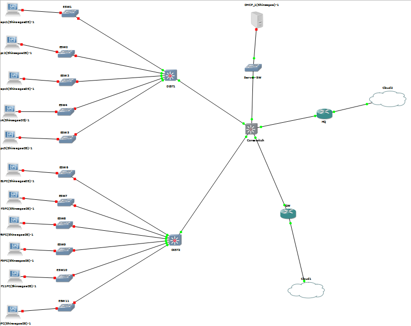

# department-store-network
GNS3 기반 백화점 통합 네트워크 인프라 구축 프로젝트
# 백화점 온·오프라인 통합 IT 인프라 구축

**GNS3 기반 네트워크 설계·구축 및 트러블슈팅 프로젝트**

| 구분 | 내용 |
|---|---|
| 프로젝트 기간 | 2026.09.17 ~ 2026.09.23 |
| 프로젝트 형태 | 코리아IT아카데미 교육과정 팀 프로젝트 (5인) |
| 담당 영역 | 강남점 네트워크 설계 및 구축 |
| 사용 기술 | GNS3, Cisco IOS, VLAN, VLSM, Inter-VLAN Routing, OSPF, DHCP Relay, Rocky Linux 9 |

## 1. 프로젝트 개요

명동 본사, 강남점, 센텀시티점, 데이터센터를 연결하는 백화점 통합 IT 인프라를 설계하고 GNS3 환경에서 구현하는 교육용 SI 프로젝트입니다.

전체 네트워크는 명동 본사를 중심으로 각 지점과 데이터센터가 연결되는 구조이며, 저는 **강남점 네트워크 설계 및 구축을 주도적으로 담당**했습니다.

## 2. 주요 수행 업무

- 지정된 `10.10.8.0/22` 주소 대역을 부서별 단말 수와 운영 목적에 맞춰 VLSM 방식으로 서브넷 설계
- 매장운영, 영업/판매지원, VIP/고객서비스, 시설관리, 보안관리, 층별 구역, POS 네트워크를 VLAN으로 분리
- GNS3에서 Access Switch–Distribution Switch–Core Switch 계층형 네트워크 구성
- Access Port, Trunk Port, SVI 및 Inter-VLAN Routing 설정
- DIST–Core 간 /30 Transit Network 구성 및 OSPF 동적 라우팅 적용
- Rocky Linux 9 기반 DHCP 서버와 VLAN별 DHCP Relay 구성 및 주소 할당 테스트
- 본사 연결을 위한 WAN 라우터 연동 및 팀 간 주소 체계 조율

## 3. 네트워크 설계

### 강남점 네트워크 토폴로지



### VLAN 및 IP 주소 설계

| VLAN | 구역 | 네트워크 | 게이트웨이 |
|---|---|---|---|
| 10 | 매장운영 | 10.10.8.0/25 | 10.10.8.1 |
| 20 | 영업/판매지원 | 10.10.8.128/25 | 10.10.8.129 |
| 30 | VIP/고객서비스 | 10.10.9.0/26 | 10.10.9.1 |
| 40 | 시설관리 | 10.10.9.64/26 | 10.10.9.65 |
| 50 | 보안관리 | 10.10.9.128/26 | 10.10.9.129 |
| 70 | B2–B1 | 10.10.10.0/25 | 10.10.10.1 |
| 80 | F1–F3 | 10.10.10.128/25 | 10.10.10.129 |
| 90 | F4–F6 | 10.10.11.0/26 | 10.10.11.1 |
| 100 | F7–F9 | 10.10.11.64/26 | 10.10.11.65 |
| 110 | F10–F11 | 10.10.11.128/26 | 10.10.11.129 |
| 120 | POS | 10.10.11.192/26 | 10.10.11.193 |

### 네트워크 구성

```text
강남점 PC / POS
       |
Access Switch (ESW1~ESW11)
       |
    Trunk
       |
DIST1 / DIST2
       |
 L3 Transit
       |
   CoreSwitch
       |
       +--- Server-SW --- Rocky Linux DHCP Server
       |
       +--- WAN Router --- 본사 연결 구간
```

## 4. 주요 트러블슈팅

### CASE 01 — VLAN 간 통신 실패

**문제:** PC에서 자신의 VLAN 게이트웨이까지 Ping이 성공했지만 다른 VLAN으로 통신하지 못했습니다.

**원인 및 해결:** VLAN과 SVI 설정 외에 L3 라우팅 활성화가 필요함을 확인하고, DIST 장비에서 `ip routing`을 적용했습니다.

**학습:** VLAN 분리와 VLAN 간 라우팅은 별개의 설정 단계라는 점을 이해했습니다.

### CASE 02 — DHCP 주소 할당 실패

**문제:** DHCP 서버까지 Ping이 성공하고 `ip helper-address`도 설정되어 있었지만 클라이언트가 IP 주소를 받지 못했습니다.

**원인 및 해결:** 라우팅, DHCP Relay, 서버 설정을 단계적으로 점검했습니다. 이후 강사님의 기술적 자문을 통해 실습 IOS 환경에서 `service dhcp` 활성화가 필요함을 확인하고 적용하여 주소 할당에 성공했습니다.

**학습:** IP 통신 성공이 DHCP와 같은 개별 서비스의 정상 동작까지 보장하지 않는다는 점을 배웠습니다.

### CASE 03 — 팀 통합 과정의 IP 대역 충돌

**문제:** 강남점과 본사 네트워크를 통합하는 과정에서 Transit IP 대역이 중복되었습니다.

**해결:** 전체 주소 계획을 확인하고 Core–HQ 연결을 `192.168.40.12/30`으로 조정했습니다.

**학습:** 여러 사이트를 통합하기 전 사용자망, 서버망, Transit망, WAN망의 주소 중복을 검토해야 함을 확인했습니다.

## 5. 네트워크 검증

GNS3 환경에서 Cisco IOS 명령어를 사용하여 구성 상태를 확인했습니다.

```bash
show vlan-switch
show interfaces trunk
show ip interface brief
show ip ospf neighbor
show ip route
```

CoreSwitch의 `show ip route` 결과에서 `O`로 표시된 OSPF 학습 경로를 확인했습니다.

DHCP 테스트에서는 VLAN별 자동 주소 할당을 확인했으며, 장애 발생 시 PC → Gateway → DIST → Core → Server 순서로 구간을 분리하여 진단했습니다.

## 6. 프로젝트를 통해 배운 점

이번 프로젝트에서는 IP 주소를 계산하는 것에서 끝나지 않고, 실제 네트워크 장비에 VLAN·라우팅·DHCP 설정을 적용하고 통신을 검증했습니다.

특히 장애가 발생했을 때 전체 설정을 무작정 변경하기보다, **통신 경로를 구간별로 나누고 처음 실패하는 지점을 찾는 문제 해결 방식**을 익혔습니다.

또한 팀원 및 강사님과 기술적인 문제를 공유하면서 개별 지점의 네트워크가 전체 기업 인프라와 연결되기 위해서는 주소 체계와 라우팅 정책의 일관성이 중요하다는 점을 배웠습니다.

---

*본 프로젝트는 실제 기업 운영망이 아닌 교육용 가상 환경에서 수행한 팀 프로젝트입니다.*
